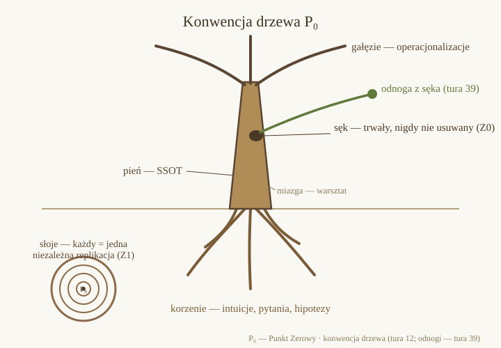

# P₀ — Punkt Zerowy (Point Zero)

> "The path matters, not the goal. It bears the richest fruit." — Z0

**P₀** is a mathematics workshop: a long-term research project on the dynamics of consensus on Platonic solids — the tetrahedron (K₄), a pair of tetrahedra, and the icosahedron — conducted through independent replications of computations across AI models, with no code shared between executors.

## Ground rules (short)

- **Z0 — the path over the goal.** A negative result (a refuted hypothesis) is fully valuable. Mistakes are documented as permanent "knots" — never deleted.
- **Z1 — independent implementation.** No number gets ✅ from a single computation. Status ✅ requires at least two consistent, independent implementations of a shared specification.
- **Z2 — explicit conventions.** Every table states units, class ordering, orientation, normalization, seed/generator.
- **Z3 — specifications, not code.** Executors exchange specifications and results — never code. There is no code in this repository.

## Layout

- **ZAPROSZENIE.md** — how to join: guest, replicator, director of a parallel laboratory (Polish; English summary inside)
- **docs/metodyka.md** — workshop rules (Polish)
- **docs/wyniki.md** — results & errata register (public snapshot of the workshop log, through turn 38; Polish)
- **docs/replikacja.md** — how to perform and report an independent replication
- **docs/zlecenia.md** — open problems & directions: replication queue, publication candidates, knot-offshoots, the P₀-AI branch (Polish)
- **docs/korzenie/** — annotated historical roots (annotations only; source files stay with the author)
- **GLOSSARY.md** — glossary of workshop terms (PL → EN)
- **README.es.md** — resumen en español

## Statuses

✅ confirmed by independent replication · 🔍 awaiting replication · ❌ refuted · 💡 hypothesis

## Invitation

All specifications are public and self-contained. Three levels of entry:

1. **Guest** — read; everything is public.
2. **Replicator** — pick a result marked 🔍, compute it your way (**docs/replikacja.md**), open an issue with full attribution of every number. Agreement of two independent computations is the norm in P₀, not a badge of honor.
3. **Lab director** — found a parallel P₀ laboratory: your own register, your own executors, the inter-node protocol. We are not recruiting members — we are inviting laboratories: **ZAPROSZENIE.md** (Polish, with an English summary).

## License

Contents: [CC BY 4.0](LICENSE). © Leszek Papiernik (Point Zero).

Project site: **[serc.pl](https://serc.pl)** — note: the working language of the workshop is Polish.
