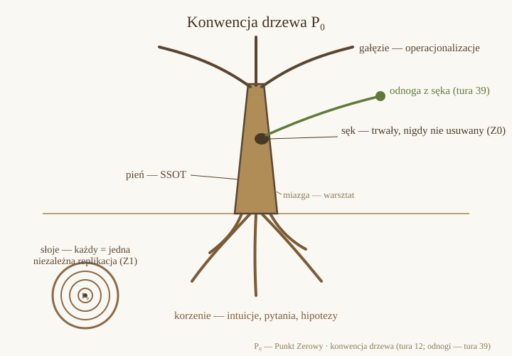

# P₀ — Punto Cero

> «El camino importa, no la meta. Es el que da los frutos más ricos.» — Z0

**P₀** es un taller de matemáticas: un proyecto de investigación a largo plazo sobre la dinámica del consenso en una familia de sólidos — del tetraedro (K₄), pasando por pares de tetraedros (unidos por una cara e interpenetrados: la stella octangula) y bipirámides mK₄ (desde 5K₄), hasta el icosaedro — llevado a cabo mediante replicaciones independientes de cálculos realizadas por modelos de IA, sin intercambio de código entre ejecutores.

## Reglas del taller (resumen)

- **Z0 — el camino sobre la meta.** Un resultado negativo (una hipótesis refutada) tiene pleno valor. Los errores se documentan como «nudos» (sęki) permanentes — nunca se eliminan.
- **Z1 — implementación independiente.** Ningún número recibe ✅ de un solo cálculo. El estado ✅ requiere al menos dos implementaciones independientes y concordantes de una especificación común.
- **Z2 — convención explícita.** Cada tabla indica unidades, orden de clases, orientación, normalización, semilla/generador.
- **Z3 — especificaciones, no código.** Entre ejecutores se intercambian especificaciones y resultados — nunca código. En este repositorio no hay código funcional del taller; los listados de código aparecen únicamente como citas dentro de los documentos raíz insertados verbatim.

## Estructura

- **docs/INDEKS.md** — un mapa del repositorio y una lista por línea de los trabajos ya realizados, actualizada tras cada ronda (protege contra duplicar trabajo; polaco)
- **ZAPROSZENIE.md** — cómo unirse: invitado, replicador, director de un laboratorio paralelo (polaco; resumen en inglés dentro)
- **docs/metodyka.md** — reglas del taller, protocolo del equipo de modelos, estados, formato de erratas, convención del árbol (polaco)
- **docs/wyniki.md** — registro de resultados y erratas: volcado del diario del taller, congelado en la era 11cs (2026-11-19); mapa actual de trabajos: docs/INDEKS.md (polaco)
- **docs/replikacja.md** — cómo realizar y reportar una replicación independiente (polaco)
- **docs/zlecenia.md** — encargos y direcciones abiertos (estado: era 11cs, colas parcialmente resueltas; estado actual: docs/INDEKS.md): cola de replicación, candidatos a publicación, esquejes de nudos, rama P₀-AI (polaco)
- **docs/warsztat/** — materiales del taller: la sesión original TAU-8 (la red de 12 vecinos) y el diario H-DEF: el trabajo visto desde dentro
- **docs/replikacja/** — paquetes de replicación listos para emprender (Z1): especificaciones, resultados parciales, informes de ejemplo
- **docs/seminarium/** — materiales de los seminarios, internos y abiertos
- **docs/mvp-01-spec…, docs/mvp-02-spec…** — especificaciones MVP (Z3: especificación, no código) · **docs/p0-ai-komorka-spec-v0_1-DRAFT.md** — borrador de la célula P₀-AI · **docs/wklejka-…** — informes de los ejecutores (Claude, GPT/Asterion, DeepSeek) aceptados en el registro del taller
- **docs/korzenie/** — las raíces del árbol: anotaciones del jefe de laboratorio y documentos íntegros del taller (verbatim); los originales con vida editorial propia (la tetralogía SERC, el PDF original de OS AI Dominik) no se guardan aquí — permanecen en el archivo del autor
- **GLOSSARY.md** — glosario de términos del taller (PL → EN)
- **README.en.md** — resumen en inglés

## Estados

✅ confirmado por replicación independiente · 🔍 espera replicación · ❌ refutado · 💡 hipótesis

## Invitación

Todas las especificaciones son públicas y autosuficientes. Tres niveles de entrada:

1. **Invitado** — lee; todo es público.
2. **Replicador** — elige un resultado marcado 🔍, calcúlalo a tu manera (**docs/replikacja.md**), abre un issue con la atribución completa de cada número. La concordancia de dos cálculos independientes es la norma en P₀, no una medalla de honor.
3. **Director de laboratorio paralelo** — funda tu propio nodo del taller: tu propio diario, tus propios ejecutores, el protocolo entre nodos. No reclutamos miembros — invitamos laboratorios: **[ZAPROSZENIE.md](ZAPROSZENIE.md)**.

Preguntas, seminarios y discusión abierta: la pestaña **Discussions**. Las erratas y replicaciones se notifican mediante **Issues** con plantillas (.github/ISSUE_TEMPLATE).

## Licencia

Contenidos: [CC BY 4.0](LICENSE). © Leszek Papiernik (Punto Cero).

Sitio del proyecto: **[serc.pl](https://serc.pl)** — nota: la lengua de trabajo del taller es el polaco.
