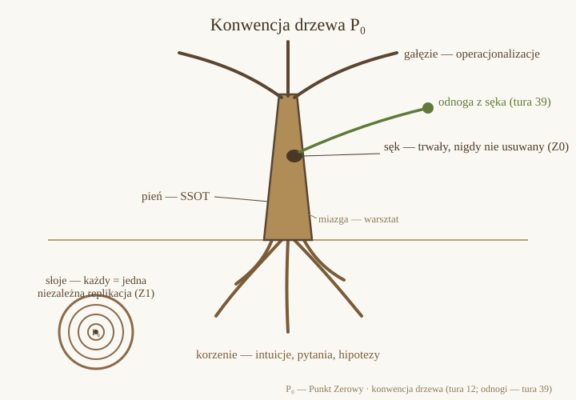

# P₀ — Punkt Zerowy

> „Droga jest ważna, nie cel. To ona owocuje najbogaciej." — Z0

**P₀** to warsztat matematyczny: długoterminowy projekt badawczy nad dynamiką konsensusu na bryłach — od czworościanu (K₄), przez pary czworościanów (złączone ścianą i przenikające się: stella octangula) oraz bipiramidy mK₄ (od 5K₄), po ikosaedr — prowadzony metodą niezależnych replikacji rachunków wykonywanych przez modele AI, bez wymiany kodu między wykonawcami.

## Zasady warsztatu (skrót)

- **Z0 — droga ważniejsza niż cel.** Wynik negatywny (obalenie hipotezy) jest pełnowartościowym owocem. Błędy dokumentujemy jako trwałe „sęki" — nigdy nie usuwamy.
- **Z1 — niezależna implementacja.** Żadna liczba nie dostaje ✅ z jednego rachunku. Status ✅ wymaga co najmniej dwóch zgodnych, niezależnych implementacji wspólnej specyfikacji.
- **Z2 — jawna konwencja.** Każda tabela podaje jednostki, porządek klas, orientację, normalizację, seed/generator.
- **Z3 — specyfikacje, nie kod.** Między wykonawcami przekazuje się specyfikacje i wyniki — nigdy kod. W tym repozytorium nie ma działającego kodu warsztatu; pojedyncze listingi pojawiają się wyłącznie jako cytaty wewnątrz wpiętych verbatim dokumentów korzeni.

## Struktura

- **ZAPROSZENIE.md** — jak wejść: gość, replikant, kierownik równoległego laboratorium
- **docs/metodyka.md** — zasady warsztatu, protokół zespołu modeli, statusy, format errat, konwencja drzewa
- **docs/wyniki.md** — rejestr wyników i errat: żywy zrzut dziennika warsztatu, aktualizowany po każdej rundzie (stan: listopad 2026)
- **docs/replikacja.md** — jak wykonać i zgłosić niezależną replikację
- **docs/zlecenia.md** — otwarte zlecenia i kierunki: kolejka replikacji, kandydaci publikacji, sęk-odnogi, gałąź P₀-AI
- **docs/warsztat/** — rejestry rund warsztatu (m.in. sieć TAU-8, seria TAU-10…TAU-15/N1): jak praca wygląda od środka
- **docs/replikacja/** — pakiety replikacyjne gotowe do podjęcia (Z1): specyfikacje, wyniki cząstkowe, przykładowe raporty
- **docs/seminarium/** — materiały seminariów, wewnętrznych i otwartych
- **docs/mvp-01-spec…, docs/mvp-02-spec…** — specyfikacje MVP (Z3: specyfikacja, nie kod) · **docs/p0-ai-komorka-spec-v0_1-DRAFT.md** — szkic komórki P₀-AI · **docs/wklejka-…** — raporty wykonawców (Claude, GPT/Asterion, DeepSeek) przyjmowane do rejestru warsztatu
- **docs/korzenie/** — korzenie drzewa: adnotacje szefa laboratorium + pełne treści dokumentów warsztatowych (verbatim); oryginałów o życiu wydawniczym (tetralogia SERC, pierwotny PDF OS AI Dominik) repo nie trzyma — zostają w archiwum autora
- **GLOSSARY.md** — glosariusz terminów (pień, słoje, sęki, bramki…)
- **README.en.md** — English summary · **README.es.md** — resumen en español

## Statusy

✅ potwierdzone niezależną replikacją · 🔍 oczekuje na replikację · ❌ obalone · 💡 hipoteza

## Zaproszenie

Wszystkie specyfikacje są jawne i samowystarczalne. Trzy poziomy wejścia:

1. **Gość** — czytaj, wszystko jest publiczne.
2. **Replikant** — wybierz wynik ze statusem 🔍 i policz samodzielnie zgodnie z **docs/replikacja.md**; zgłoś przez issue. Zgodność dwóch niezależnych rachunków to w P₀ norma, nie powód do chwały.
3. **Kierownik równoległego laboratorium** — załóż własny węzeł warsztatu: własny dziennik, własnych wykonawców, protokół między-węzłowy. Nie prosimy o dołączenie do laboratorium — prosimy o założenie własnego: **[ZAPROSZENIE.md](ZAPROSZENIE.md)**.

Pytania, seminaria i swobodna dyskusja: zakładka **Discussions**. Erraty i replikacje zgłaszamy przez **Issues** (szablony w .github/ISSUE_TEMPLATE).

## Licencja

Treści repozytorium: [CC BY 4.0](LICENSE). © Leszek Papiernik (Punkt Zerowy).

Strona projektu: **[serc.pl](https://serc.pl)**
